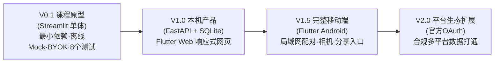
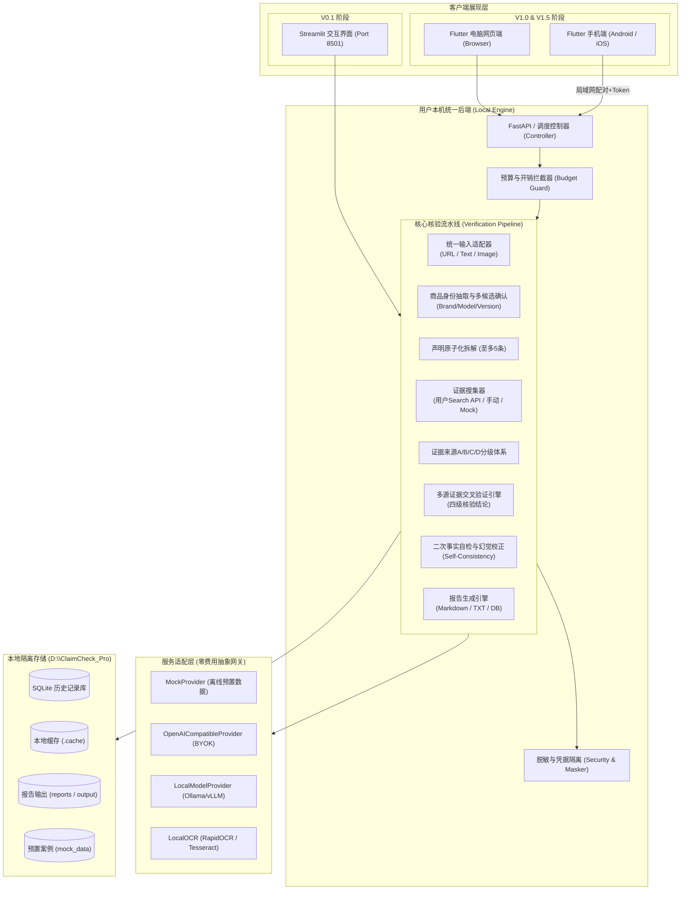
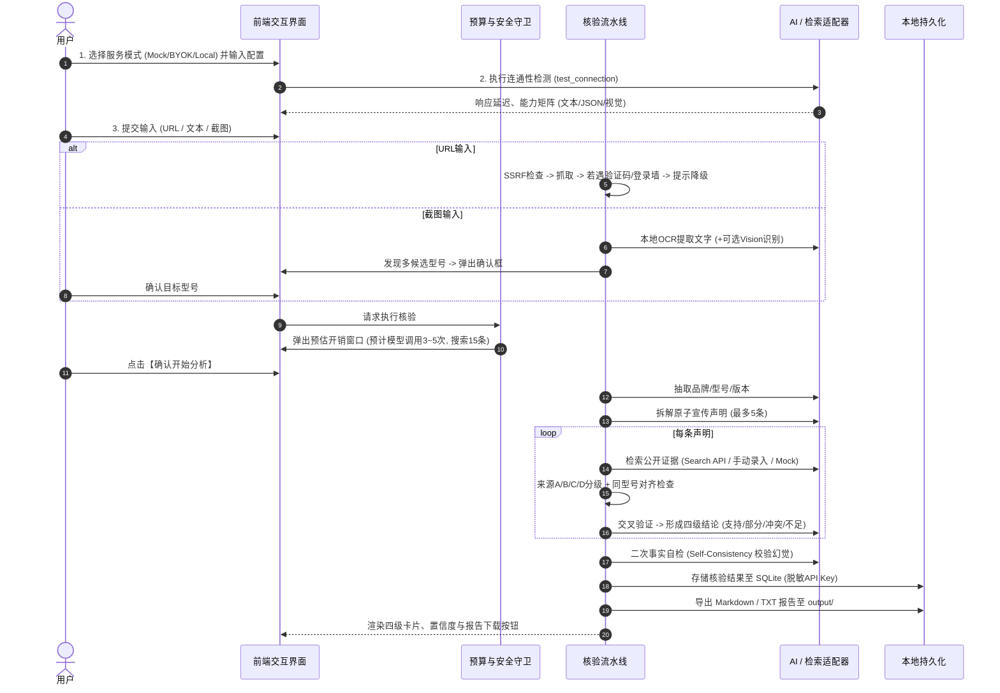

# ClaimCheck Pro 实施规划与技术方案设计 (IMPLEMENTATION PLAN)

> **项目名称**：ClaimCheck Pro - 跨平台商品真实性与一致性核验智能体  
> **设计日期**：2026-10-16  
> **当前状态**：全阶段（阶段 1 ~ 阶段 5）实施已全面完成，`V0.1.8 Final` 终验交付通过  
> **核心原则**：**本地优先 · 用户自带API (BYOK) · 开发者零费用承担**

---

## 一、产品范围与设计原则 (Scope & Principles)

### 1.1 产品定位与使命
ClaimCheck Pro 是一款面向消费者、电商运营者和质检辅助人员的跨平台商品真实性与一致性核验工具。其核心任务是**基于公开证据，核验商品宣传声明的真实性与严谨性**。
系统通过接收公开商品链接、商品详情文本或商品截图，自动抽取商品身份（品牌、型号、规格），拆解至多 5 条宣传要点，通过多源网络检索与本地模型/用户自备云端模型交叉比对官方规格说明与评测证据，最终给出四级核验结论与详实的追溯报告。

### 1.2 核心设计原则
1. **零费用架构 (Zero-Cost Architecture)**：
   - 开发者不承担任何用户的模型、网络搜索、OCR、云存储或服务器流量费用。
   - 不预置任何由开发者付费的默认 API Key 或云端代理。
   - 任何第三方调用失败时，**绝对不自动回退到开发者付费服务**。
2. **三类运行模式**：
   - **Mock演示模式**：内置完整离线案例（蓝牙耳机、充电宝、候选确认、证据不足等），无网无Key也可跑通全流程答辩与演示，界面明确标识“演示数据”。
   - **用户自带API模式 (BYOK)**：用户自行输入 OpenAI 兼容的 Base URL、API Key 与 Model 名称，可独立配置文本模型、视觉模型与搜索服务。
   - **用户本地模型模式**：支持连接用户电脑或局域网内的 Ollama、vLLM、LocalAI 等兼容端点，配合纯本地 OCR，保障隐私与纯离线可用。
3. **调用预算与开销控制**：
   - 单次分析严格限制：最多 5 条宣传声明；每条声明搜索 3~5 条证据；文本模型最多调用 3~5 次；视觉模型最多 1 次；重试最多 1~2 次；任务单次超时 60~120 秒。
   - 在触发分析前，必须向用户弹出**调用预算与费用承担方确认窗口**，用户可随时取消。
4. **合规、安全与非侵入性**：
   - 严格遵守电商平台反爬规则，遇登录墙、验证码、滑块或 App 专属页面直接优雅降级为文本/截图输入，**绝不逆向协议或绕过反爬机制**。
   - 不索取、不收集、不存储用户的淘宝、拼多多、京东等平台账号与密码。
   - 结论中立客观：**不得把“没有检索到证据”判定为“虚假宣传”**，不得出具法定鉴定结论或欺诈指控，附带明确的免责声明。

---

## 二、版本演进与版本边界 (Version Boundaries)



### 详细版本边界矩阵

| 功能维度 | V0.1 课程原型 (当前阶段重点) | V1.0 本机产品 | V1.5 完整移动端 | V2.0 平台扩展 |
| :--- | :--- | :--- | :--- | :--- |
| **前端展现** | Streamlit 交互式Web应用 (本地单进程) | Flutter Web (响应式多栏布局) | Flutter Android APP (卡片折叠面板) | Flutter Web + Android + 预留iOS |
| **后端架构** | Streamlit 内部服务编排 | 独立 FastAPI RESTful 统一后端 (127.0.0.1) | FastAPI 增加局域网配对服务与Token鉴权 | FastAPI 企业级/多端协同服务 |
| **服务模式** | Mock模式 / BYOK / 本地模型 | Mock模式 / BYOK / 本地模型 | 手机端连接电脑后端，手机不存Key | 支持多设备同步与团队配置分享 |
| **输入方式** | 链接输入、文本粘贴、本地截图上传 | 链接、文本、多图拖拽批量上传 | 相机即时拍摄、系统分享面板链接直接唤醒 | 官方开放平台授权数据直连 |
| **OCR与视觉** | 本地纯Python/轻量OCR + 可选Vision API | 异步后台OCR处理任务池 | 移动端拍摄质量检测与本地边缘轻量裁切 | 云边协同OCR |
| **数据持久化** | 内存状态 + 本地 JSON/Markdown 导出 | 本地 SQLite 历史库 (CRUD) | 本地 SQLite 历史库 + 手机端同步查看 | 本地加密数据库 |
| **报告导出** | Markdown (.md), 纯文本 (.txt) | Markdown, TXT, Word (.docx) | PDF, Word, 手机端一键分享图片卡片 | 自定义排版 PDF / 商业合规报告 |
| **测试验收** | 8大固定测试 (T01~T08) 全自动/半自动跑通 | 接口单元测试 + Flutter UI集成测试 | 移动端端到端联调测试 | 自动化合规基线测试 |

---

## 三、系统架构设计 (System Architecture)

### 3.1 总体架构拓扑图



### 3.2 核心业务流程时序



---

## 四、项目目录结构规范 (Project Directory Structure)

根据用户指令与严格的工作区限制，所有项目代码、虚拟环境、缓存、构建产物必须统一约束在 `D:\ClaimCheck_Pro` 内。

```text
D:\ClaimCheck_Pro\
│
├── .cache\                         # [必须] 项目专用缓存 (pip/wheel/临时缓存)
├── .venv\                          # [必须] Python 虚拟环境 (隔离运行)
├── downloads\                      # [必须] 运行过程中下载的临时文件/网页
├── mock_data\                      # [必须] 离线演示数据 (4~6个标准案例JSON)
├── output\                         # [必须] 用户导出的结果、报告与中间物
├── reports\                        # [必须] 自动化测试报告与执行日志
├── screenshots\                    # [必须] 测试用商品截图与样例输入
├── tools\                          # [必须] 运维工具、文档抽取、辅助脚本
│   ├── read_docs.py                # 文档解析读取脚本
│   └── ...
│
├── docs\                           # 项目设计文档与参考规范
│   ├── ClaimCheck_Pro_零费用架构项目概述.docx (只读原件)
│   └── ClaimCheck_Pro_零费用架构实施步骤.docx (只读原件)
│
├── src\                            # 核心业务源代码 (前后端演进共享逻辑)
│   ├── core\                       # 核心基础库
│   │   ├── __init__.py
│   │   ├── config.py               # 环境变量与用户配置模型 (Pydantic)
│   │   ├── paths.py                # 路径管理与严格工作区锁定 (D:\ClaimCheck_Pro)
│   │   ├── security.py             # 凭据脱敏、加密存储与SSRF防护
│   │   └── logger.py               # 脱敏日志记录器
│   │
│   ├── models\                     # Pydantic 数据模式定义
│   │   ├── __init__.py
│   │   ├── product.py              # 商品身份模型 (Brand, Model, Version...)
│   │   ├── claim.py                # 宣传声明模型 (Claim, Category...)
│   │   ├── evidence.py             # 证据模型 (SourceLevel, URL, Snippet...)
│   │   ├── verification.py         # 核验结论模型 (4级结论枚举, 置信度)
│   │   └── report.py               # 报告聚合模型
│   │
│   ├── providers\                  # 统一 AI 网关适配层
│   │   ├── __init__.py
│   │   ├── base.py                 # AIProvider 抽象基类接口
│   │   ├── mock_provider.py        # 离线演示 Mock 适配器
│   │   ├── openai_provider.py      # OpenAI 兼容协议适配器 (BYOK)
│   │   ├── local_provider.py       # 本地模型适配器 (Ollama/vLLM)
│   │   └── checker.py              # 连通性与能力检测套件
│   │
│   ├── crawlers\                   # 统一输入与网页解析
│   │   ├── __init__.py
│   │   ├── ssrf_filter.py          # 安全网络访问与内网IP拦截
│   │   ├── url_extractor.py        # HTTP请求与JSON-LD Product解析
│   │   └── fallback_handler.py     # 登录墙/验证码检测与降级响应
│   │
│   ├── ocr\                        # 图像处理与本地 OCR
│   │   ├── __init__.py
│   │   ├── image_utils.py          # Pillow 缩放/压缩/脱敏检查
│   │   └── local_ocr.py            # 本地纯离线 OCR 引擎适配
│   │
│   ├── search\                     # 证据检索模块
│   │   ├── __init__.py
│   │   ├── base.py                 # 搜索服务接口
│   │   ├── byok_search.py          # 用户自带搜索 API (Tavily/Serper/Custom)
│   │   └── manual_collector.py     # 用户手动录入线索收集器
│   │
│   ├── verifier\                   # 核心交叉验证流水线
│   │   ├── __init__.py
│   │   ├── budget.py               # 调用预算与开销评估器
│   │   ├── identity_extractor.py   # 商品身份抽取与多候选生成
│   │   ├── claim_decomposer.py     # 声明原子化拆解 (<=5条)
│   │   ├── evidence_classifier.py  # A/B/C/D 证据来源分级
│   │   ├── model_alignment.py      # 同型号精确对齐校验
│   │   ├── cross_verifier.py       # 多源交叉验证与结论判定
│   │   ├── fact_checker.py         # 二次事实自检 (Self-Consistency)
│   │   └── orchestrator.py         # 核验全流程编排器
│   │
│   ├── reports\                    # 报告导出与渲染
│   │   ├── __init__.py
│   │   ├── generator.py            # 报告组装器
│   │   ├── exporters.py            # Markdown, TXT 导出器
│   │   └── disclaimer.py           # 法律免责与非鉴定声明
│   │
│   ├── storage\                    # 本地数据持久化
│   │   ├── __init__.py
│   │   ├── db.py                   # SQLite 数据库连接与迁移
│   │   └── crud.py                 # 历史记录增删查改
│   │
│   ├── ui\                         # V0.1 Streamlit 前端界面
│   │   ├── __init__.py
│   │   ├── app.py                  # Streamlit 主入口页面
│   │   ├── components\             # UI 组件库 (配置栏/输入Tab/卡片/弹窗)
│   │   └── styles\                 # CSS 样式增强
│   │
│   └── backend\                    # V1.0 预留 FastAPI 后端路由服务
│       ├── __init__.py
│       └── main.py
│
├── tests\                          # 自动化测试套件 (覆盖8大固定测试)
│   ├── __init__.py
│   ├── conftest.py                 # 测试夹具与环境隔离
│   ├── fixtures\                   # 离线测试HTML、截图与Mock报文
│   │   ├── static_product.html     # 静态公开商品页样本
│   │   ├── login_wall.html         # 模拟反爬登录页
│   │   ├── test_earphone.png       # 测试用耳机截图
│   │   └── multi_model.png         # 多型号候选测试截图
│   ├── test_t01_mock_offline.py    # T01 测试用例
│   ├── test_t02_byok_config.py     # T02 测试用例
│   ├── test_t03_local_model.py     # T03 测试用例
│   ├── test_t04_url_crawler.py     # T04 测试用例
│   ├── test_t05_candidate_confirm.py # T05 测试用例
│   ├── test_t06_supported_cases.py # T06 测试用例
│   ├── test_t07_conflict_cases.py  # T07 测试用例
│   └── test_t08_crawler_fallback.py# T08 测试用例
│
├── .env.example                    # 环境配置模板 (绝无真实密钥)
├── .gitignore                      # 严格忽略 .venv, .cache, 密钥与临时输出
├── IMPLEMENTATION_PLAN.md          # 实施方案与技术设计 (本文件)
├── PROJECT_STATE.md                # 项目当前状态跟踪
├── REQUIREMENTS_TRACEABILITY.md    # 需求跟踪矩阵
├── PROGRESS.md                     # 开发进度记录表
├── README.md                       # 项目启动与使用手册
└── requirements.txt                # Python 依赖清单
```

---

## 五、分阶段开发顺序与实施路线 (Phased Roadmap)

### 阶段 0：需求分析、架构规划与环境基线（【当前已完成】）
- 目标：建立完备的架构方案、需求跟踪矩阵、状态跟踪与进度表；配置虚拟环境。
- 交付物：`IMPLEMENTATION_PLAN.md`, `PROJECT_STATE.md`, `REQUIREMENTS_TRACEABILITY.md`, `PROGRESS.md`, `requirements.txt` 初版。

### 阶段 1：核心数据模型与离线 Mock 数据体系 (V0.1 基础)
- 目标：定义核心数据结构；固化 4~6 个预置案例（蓝牙耳机降噪、充电宝快充、多候选确认、证据不足用例等）。
- 涉及文件：`src/models/`, `mock_data/`, `src/mock/mock_data.py`。
- 测试：离线数据加载单元测试。

### 阶段 2：零费用 Provider 适配层与能力检测
- 目标：实现 `MockProvider`, `OpenAICompatibleProvider`, `LocalModelProvider`；连通性检测与能力自适应。
- 涉及文件：`src/providers/`。
- 测试：**T01**, **T02**, **T03**。

### 阶段 3：多源输入接入、本地预处理与降级机制
- 目标：URL安全抓取 (SSRF防御) 与 JSON-LD 提取；登录墙/验证码识别降级；文本清洗；本地截图优化与本地 OCR 文本抽取。
- 涉及文件：`src/crawlers/`, `src/parsers/`, `src/ocr/`。
- 测试：**T04**, **T08**。

### 阶段 4：商品身份确认与宣传声明拆解 (<=5条)
- 目标：商品品牌、型号、版本抽取；多相似型号候选交互机制 (最多3个)；声明原子化拆解与分类。
- 涉及文件：`src/verifier/identity_extractor.py`, `src/verifier/claim_decomposer.py`。
- 测试：**T05**。

### 阶段 5：证据检索适配、来源分级与多源交叉验证引擎
- 目标：证据检索适配；A/B/C/D 证据来源分级；同型号对齐；四级结论判定（支持/部分/冲突/不足）；二次事实自检 (Self-Consistency)；免责声明注入。
- 涉及文件：`src/search/`, `src/verifier/`。
- 测试：**T06**, **T07**。

### 阶段 6：报告生成引擎、本地存储与 Streamlit 原型整合 (V0.1 闭环)
- 目标：组装 Markdown 与 TXT 报告导出；集成 SQLite 历史记录；完成 Streamlit 界面构建与 8 个固定测试全量通过验证。
- 涉及文件：`src/reports/`, `src/storage/`, `src/ui/app.py`。
- 交付物：**可稳定在 Windows 上一键运行的 V0.1 课程原型**。

### 阶段 7：FastAPI 统一后端拆分 (V1.0)
- 目标：将核心验证流水线封装为标准的 RESTful API 接口，提供 Swagger 接口文档，实现 127.0.0.1 安全监听。
- 涉及文件：`src/backend/`。

### 阶段 8：Flutter 跨端开发 (V1.0 Web & V1.5 Android)
- 目标：开发 Flutter Web 电脑响应式布局；开发 Flutter Android APP，实现相机调用、系统分享解析与局域网安全配对。

---

## 六、第三方依赖选型与技术决策 (Dependencies & Tech Stack)

### 6.1 V0.1 核心依赖选型（严格遵照最小依赖与纯本地优先）

| 依赖包名称 | 版本建议 | 用途说明 | 选型理由与零费用考量 |
| :--- | :--- | :--- | :--- |
| `streamlit` | `>=1.32.0` | V0.1 课程原型交互界面 | 快速构建多Tab、侧边栏、卡片展示与报告下载界面，纯本地运行。 |
| `pydantic` | `>=2.6.0` | 数据模式定义与验证 | 严格校验商品身份、声明、证据与结论数据结构，保障类型安全与JSON输出解析。 |
| `requests` | `>=2.31.0` | HTTP 客户端 | 轻量请求网页、测试 API 连通性，配合自定义 Session 与超时控制。 |
| `beautifulsoup4` | `>=4.12.0` | HTML/JSON-LD 解析 | 提取商品页 DOM 与 schema.org/Product 元数据，纯本地无外部服务开销。 |
| `pillow` | `>=10.2.0` | 图像本地预处理 | 本地裁剪、格式转换、尺寸压缩，上传前脱敏检查，零外部依赖。 |
| `python-dotenv` | `>=1.0.0` | 本地环境变量读取 | 加载本地环境配置，避免硬编码。 |
| `rapidocr-onnxruntime` | `>=1.3.0` | 本地轻量离线 OCR (或Tesseract) | **纯本地 CPU 推理**，无需云端 OCR 密钥，不产生开发者或用户云端费用。 |
| `openai` | `>=1.14.0` | OpenAI 兼容客户端 | 调用用户自带 API (BYOK) 或本地 Ollama/vLLM 兼容服务。 |
| `pytest` | `>=8.0.0` | 测试框架 | 运行 8 大固定测试用例并生成自动化测试报告。 |

---

## 七、关键技术决策 (Key Technical Decisions)

1. **AI 网关解耦与多协议兼容**：
   - 决策：采用适配器模式 (Adapter Pattern)。抽象出 `AIProvider` 统一基类，`MockProvider`（本地预置）、`OpenAICompatibleProvider`（用户云端Key）与 `LocalModelProvider`（本地 Ollama）实现统一接口。
   - 优势：业务流水线无需关心后端是云端 GPT-4、DeepSeek、本地 Qwen 还是离线 Mock，切换平滑无感。
2. **本地优先的 OCR 策略**：
   - 决策：商品截图优先使用纯本地 OCR（ONNXRuntime CPU 运行轻量模型）提取文字，用户未配置视觉模型时完全不调用多模态 API。
   - 优势：杜绝云 OCR API 账单风险，断网环境依然可以提取截图信息。
3. **严格的 SSRF 与网络访问安全守卫**：
   - 决策：所有外网 URL 请求前必须经过 `ssrf_filter` 校验，解析目标 IP，拦截 `127.0.0.1`, `10.0.0.0/8`, `192.168.0.0/16`, `172.16.0.0/12` 等私有和保留地址。
   - 优势：防止被恶意利用探测用户内网服务。
4. **确定性证据分级与型号对齐算法**：
   - 决策：不完全依赖大模型的“直觉打分”，而是建立规则 + 嵌入式关键词打标机制（A/B/C/D来源白名单库 + 型号正则精确匹配）。
   - 优势：输出结论具有强可解释性、可审计性，防大模型胡言乱语。

---

## 八、风险识别与降级方案 (Risks & Fallbacks)

| 潜在风险 / 异常场景 | 触发条件 | 系统应对与降级方案 |
| :--- | :--- | :--- |
| **电商防爬封禁 / 登录拦截** | 用户输入的链接遇到淘宝、拼多多、京东的反爬验证码、滑块或重定向至登录页。 | **直接优雅降级**：立即停止自动抓取，界面弹出友善提示：“该页面需要登录或安全验证，根据合规原则停止自动访问，已为您切换为【详情文本输入】或【商品截图输入】模式”。绝不尝试破解。 |
| **用户未配置任何 Key 且网络断开** | 离线演示、答辩现场断网或无API额度。 | **自动引导至 Mock 模式**：无缝加载预置的 4~6 个典型商品案例，全流程卡片与报告正常渲染，显眼处加盖“演示数据”水印标签。 |
| **用户配置的 Key 失效 / 欠费 / 超额** | 用户填写的 API Key 余额不足或服务商宕机。 | **即时报错并停止**：API 测试窗口明确显示服务商返回的具体错误码（如 401 Unauthorized / 429 Insufficient Quota），绝不自动回退到任何开发者私有服务。 |
| **截图包含多个模糊相似型号** | 用户上传的截图中包含了该系列的Pro/Plus/标准版等多款产品。 | **多候选阻断确认**：流水线暂停后续拆解与检索，界面列出至多 3 个候选商品规格，强制用户点击确认目标型号后才进入下一步。 |
| **大模型产生幻觉 / 过度推断** | 模型因证据不全强行推断“该商品为虚假宣传”。 | **二次事实自检拦截**：校验“证据支持度”与“结论等级”，若同型号证据不足，强制修正结论为“证据不足”，并在报告中添加“缺少同型号权威证据，请人工复核”警示。 |

---

## 九、八大固定测试执行方案 (T01 ~ T08 Verification Plan)

根据两份文档要求，系统必须包含 8 个可重复执行的独立测试，并提供自动化测试脚本与测试报告：

| 用例编号 | 核心测试点 | 测试输入准备 | 预期断言与验收准则 |
| :--- | :--- | :--- | :--- |
| **T01** | Mock离线模式全流程 | `mock_data/sample_earphone.json` (断网/无Key) | 成功生成商品身份、5条拆解、4级结论与报告，报告包含“演示数据”标记。 |
| **T02** | 用户API有效与无效配置校验 | 1) 虚假Key与无效URL；2) 模拟正常响应的Mock Server | 无效时精准捕获异常并显示友好原因；有效时显示延迟与支持能力。 |
| **T03** | 本地模型连接与兼容性 | 本地 Ollama 兼容端点 (或本地Mock端点) | 验证 HTTP POST `/v1/chat/completions` 成功并完成最小文本推理。 |
| **T04** | 公开静态商品页信息抽取 | `fixtures/static_product.html` (本地静态页面) | 提取出准确的品牌、型号以及关键宣传文案。 |
| **T05** | 截图存在多个相似型号候选确认 | `fixtures/multi_model.png` (包含标准版与Pro版) | 识别出 2~3 个候选，并在用户选择前保持等待，选择后继续完成核验。 |
| **T06** | 官方证据支持与部分支持判定 | 1) 官方国标明确支持数据；2) 实验室实测缺少限定条件数据 | 案例1断言为 `有证据支持`；案例2断言为 `部分支持`。 |
| **T07** | 官方资料冲突与证据不足判定 | 1) 官方参数与宣传相左；2) 检索无结果或型号不匹配 | 案例1断言为 `存在冲突`；案例2断言为 `证据不足`，绝不断言为“欺诈/假货”。 |
| **T08** | 遇到登录或验证码页面降级处理 | `fixtures/login_wall.html` (返回302或验证码特征) | 系统识别登录墙，停止爬虫并不报错崩溃，给出降级至文本/截图模式的指示。 |

---

## 十、最终验收标准检查清单 (Acceptance Checklist)

- [x] **费用隔离**：代码库、前端、日志、配置文件中不存在任何开发者个人私有 API Key。
- [x] **模式完整**：Mock 离线演示、用户 BYOK、本地模型三模式无缝切换。
- [x] **输入三入口**：商品链接、详情文本、商品截图均可顺畅输入并正确提取商品信息。
- [x] **交互式型号确认**：面对多型号候选时，必须由用户确认后再执行核验。
- [x] **5条声明拆解**：智能拆解宣传点，单次严格限制在 5 条以内。
- [x] **证据来源分级**：对检索/输入的证据准确标注 A/B/C/D 级别并核对同型号一致性。
- [x] **四级核验结论**：结论准确归入“有证据支持”、“部分支持”、“存在冲突”、“证据不足”，不越权断言。
- [x] **二次事实自检**：具备自检回路纠正逻辑矛盾。
- [x] **报告导出**：可导出格式规范的 Markdown 与 TXT 报告，并持久化到本地。
- [x] **8个固定测试**：T01 至 T08 全部自动化执行通过，并输出测试报告。
- [x] **反爬合规降级**：遇平台限制立即终止抓取并降级，不尝试绕过或破解。
- [x] **免责声明完整**：报告与页面明确标注免责条款，不输出法定鉴定结论。
