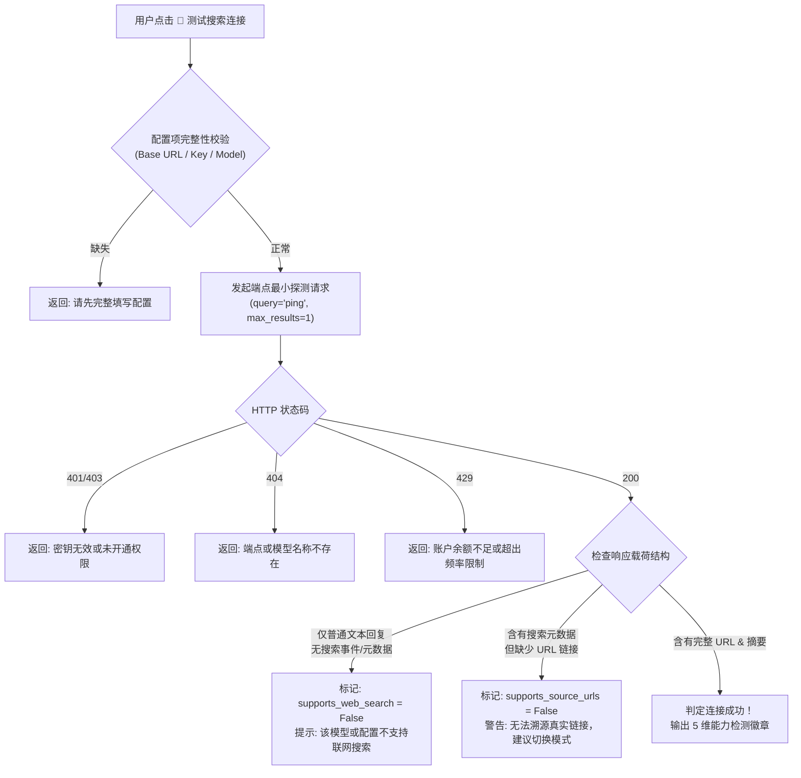

# ClaimCheck Pro 多源网络搜索服务扩展实施方案 (Multi-Search Provider Plan)

**文档版本**：V1.0  
**制定日期**：2026-10-19  
**实施项目**：ClaimCheck Pro (D:\ClaimCheck_Pro)  
**目标范围**：为 ClaimCheck Pro 扩展并完善五大网络搜索服务提供者（`TavilySearchProvider`, `KimiSearchProvider`, `QwenSearchProvider`, `ManualEvidenceProvider`, `NoSearchProvider`），实现独立能力检测、多维调用预算、来源真实性追溯与会话级安全隔离。

---

## 一、核心原则与设计铁律

1. **开发者零费用原则 (Zero Developer Cost)**：
   - 开发者不提供任何公共 API Key、共享额度或代理中转服务器；
   - 所有商业搜索服务（Tavily、Kimi、Qwen/通义千问）的凭据均由终端用户自主提供；
   - 搜索失败或未配置时，严格禁止回退至任何开发者付费服务，外部网络检索请求数严格为 0。

2. **模型服务与搜索服务逻辑彻底解耦 (Service Decoupling)**：
   - **LLM Provider**：专职负责商品文本理解、宣传卖点原子化拆解、已有证据归纳、型号严格对齐、四级结论生成、二次事实自检与报告生成；
   - **Search Provider**：专职负责依据商品型号与声明生成真实检索词、调用合法公开搜索接口、返回可溯源的标题/URL/摘要/域名、获取候选网页正文；
   - **严禁能力混淆**：不得因为用户配置了 Kimi 或千问的 LLM 对话模型，就默认其联网搜索能力可用；必须通过独立的搜索端点与搜索能力探测进行显式校验。

3. **数据与证据绝对真实可追溯 (Traceable Truthfulness)**：
   - 严禁伪造、捏造任何虚假检索结果或来源 URL；
   - 针对大模型搜索返回的结果，若仅有模型生成文本而缺少明确来源 URL，**一律不得标记为实时可追溯网络核验证据**，且**绝对禁止评定为 A 级（官方资料）证据**；
   - 报告中必须完整呈现实际使用的 Search Provider、检索查询词清单、实际请求量、真实网页 URL 及来源等级。

4. **公网安全与零信任防护 (Zero-Trust Security)**：
   - 仅允许安全的 HTTPS 公网 API 端点，防止中间人窃听与端点篡改；
   - 外部网页抓取继续强制执行 SSRF 安全网关过滤（阻断 127.0.0.1、内网网段与云厂商元数据端点）；
   - 严格尊重目标平台安全策略，遇到登录墙、滑块验证码或反爬拦截立即触发合规降级保护，绝不破解或盗用 Cookie；
   - 用户 API Key 严格驻留于 `st.session_state` 内存会话中，日志、截图、报告与 Git 仓库严格执行全链路脱敏。

---

## 二、支持的五大 Search Provider 架构与职责矩阵

```
+---------------------------------------------------------------------------------------------------------+
|                                    ClaimCheck Pro 统一搜索提供者架构                                    |
+---------------------------------------------------------------------------------------------------------+
|                                       SearchProvider 统一抽象基类                                        |
|  - test_connection() -> SearchConnectionResult (含5维能力检测矩阵)                                     |
|  - search(query: str, max_results: int) -> List[SearchResultItem]                                      |
|  - fetch_page(url: str) -> Optional[WebPageExcerptResult] (可选原生网页正文提取)                         |
|  - sanitize_result(...) -> SearchResultItem                                                             |
|  - capabilities() -> Dict[str, Any]                                                                    |
+---------------------+-------------------+-------------------+-------------------+-----------------------+
|          1          |         2         |         3         |         4         |           5           |
|  TavilySearch       |   KimiSearch      |   QwenSearch      |  ManualEvidence   |   NoSearchProvider    |
|     Provider        |     Provider      |     Provider      |     Provider      |       (Default)       |
+---------------------+-------------------+-------------------+-------------------+-----------------------+
| - 国际化专业搜索API | - Moonshot独立工具| - 阿里百炼官方API | - 用户自主提供URL | - 离线无网/免Key运行  |
| - POST /search      | - POST /tools/    | - Responses API   | - 品牌官网/说明书 | - 请求数严格为 0      |
| - 用户自带Key       |   search / fetch  | - Chat + search   | - 规格页/专业评测 | - 零外部检索费用      |
| - 毫秒级结构化返回  | - 独立计费与正文  | - web_extractor   | - 零 API 费用     | - 绝不捏造假结果      |
+---------------------+-------------------+-------------------+-------------------+-----------------------+
```

### 1. 统一数据结构定义

```python
class SearchResultItem(BaseModel):
    """统一搜索结果结构"""
    title: str = Field(default="", description="网页标题")
    url: str = Field(default="", description="规范化完整 URL")
    snippet: str = Field(default="", description="搜索摘要")
    domain: str = Field(default="", description="来源主域名")
    published_at: Optional[str] = Field(default=None, description="发布或抓取时间")
    provider: str = Field(default="", description="提供者标识 (tavily/kimi/qwen/manual/none)")
    query: str = Field(default="", description="命中的检索查询词")
    result_rank: int = Field(default=0, description="在当前搜索结果集中的排序序号 (1-indexed)")

class SearchCapabilities(BaseModel):
    """5维独立能力检测矩阵"""
    supports_text_model: bool = Field(default=False, description="文本模型通信是否正常")
    supports_web_search: bool = Field(default=False, description="联网搜索工具是否可用")
    supports_source_urls: bool = Field(default=False, description="是否支持返回结构化来源 URL")
    supports_web_extractor: bool = Field(default=False, description="是否支持网页正文提取器")
    supports_responses_api: bool = Field(default=False, description="是否支持 Responses API 架构")

class SearchConnectionResult(BaseModel):
    """扩展后的搜索连通性与密钥测试结果"""
    success: bool = Field(..., description="是否连接成功并具备基础搜索能力")
    provider_name: str = Field(..., description="提供者名称")
    supports_search: bool = Field(default=True, description="搜索功能是否就绪")
    response_time_ms: int = Field(default=0, description="请求往返耗时 (毫秒)")
    results_count: int = Field(default=0, description="返回结果数")
    status_code: Optional[int] = Field(default=None, description="HTTP 状态码")
    error_message: Optional[str] = Field(default=None, description="中文化友好提示")
    masked_api_key: str = Field(default="", description="脱敏后的 API Key")
    # 5维能力检测
    capabilities: SearchCapabilities = Field(default_factory=SearchCapabilities)
```

---

## 三、各 Search Provider 深度技术规范

### 1. KimiSearchProvider (Moonshot 官方独立搜索工具接口)

全面弃用即将下线的旧版 `builtin_function.$web_search`，采用 Moonshot AI 官方提供的独立 REST 工具 API。

- **官方端点规范**：
  - 默认国内 Base URL：`https://api.moonshot.cn/v1`（支持用户配置自定义 Base URL）
  - 基础搜索：`POST {base_url}/tools/search`
  - 深度专业搜索：`POST {base_url}/tools/search_pro`
  - 网页正文提取：`POST {base_url}/tools/fetch`
- **配置参数**：
  1. `kimi_base_url`：默认 `https://api.moonshot.cn/v1`（严格校验 HTTPS）
  2. `kimi_api_key`：用户自带密钥（脱敏显示为 `sk-****`）
  3. `kimi_search_mode`：`basic`（对应 `/tools/search`）或 `pro`（对应 `/tools/search_pro`）
  4. `kimi_max_results`：每条声明最大检索数（1 - 10 条，默认 5）
  5. `kimi_max_fetches`：最大网页抓取数（1 - 5 篇，默认 3）
  6. `kimi_timeout`：超时时间（5 - 30 秒，默认 15）
- **接口调用与数据清洗**：
  - **搜索请求**：
    ```json
    POST /v1/tools/search (或 /v1/tools/search_pro)
    Headers: {
      "Authorization": "Bearer sk-...",
      "Content-Type": "application/json"
    }
    Body: {
      "text_query": "声学极客 SoundPro X1 降噪48dB 官方规格",
      "limit": 5
    }
    ```
  - **搜索响应映射**：
    ```json
    {
      "results": [
        {
          "title": "SoundPro X1 官方规格参数",
          "url": "https://www.soundgeek.cn/x1/specs",
          "snippet": "双馈主动降噪，降噪深度最高达48dB...",
          "published_at": "2026-03-15"
        }
      ]
    }
    ```
    解析清洗为 `SearchResultItem`，验证 URL 协议并过滤特殊控制字符。
  - **网页提取请求**：
    ```json
    POST /v1/tools/fetch
    Headers: { "Authorization": "Bearer sk-...", "Content-Type": "application/json" }
    Body: { "url": "https://www.soundgeek.cn/x1/specs" }
    ```
  - **提取响应映射**：
    返回 `{"title": "...", "content": "# Markdown 正文..."}`，直接组装为 `WebPageExcerptResult`，无缝供后续证据等级分类器与型号对齐模块使用。
- **独立能力测试 (test_connection)**：
  - 发送最小探测请求：`query="ping", limit=1` 至 `/tools/search`；
  - 若调用成功且返回有效结构，判定：
    - `supports_text_model = True`
    - `supports_web_search = True`
    - `supports_source_urls = True`
    - `supports_web_extractor = True` (探测 `/tools/fetch`)
    - `supports_responses_api = False`（不属于 Responses 架构）

---

### 2. QwenSearchProvider (阿里百炼 DashScope 官方搜索服务)

支持两种架构模式，并在前端显著推荐 **Responses API 模式**，以确保获取结构化可溯源证据。

- **官方端点规范**：
  - 默认国内 Base URL：`https://dashscope.aliyuncs.com/compatible-mode/v1`（严格校验 HTTPS）
  - 模式 A（Responses API 端点）：`POST {base_url}/responses`
  - 模式 B（Chat Completions 端点）：`POST {base_url}/chat/completions`
- **配置参数**：
  1. `qwen_base_url`：默认 `https://dashscope.aliyuncs.com/compatible-mode/v1`
  2. `qwen_api_key`：用户自带密钥（脱敏显示为 `sk-****`）
  3. `qwen_model`：默认 `qwen-plus`（支持选择 `qwen-max`, `qwen-turbo` 等）
  4. `qwen_api_mode`：`responses`（首选）或 `chat_completions`
  5. `qwen_max_search_count`：每条声明最大检索数（1 - 10 次）
  6. `qwen_enable_web_extractor`：是否挂载 `web_extractor`（布尔值，默认开启）
  7. `qwen_timeout`：超时时间（5 - 30 秒，默认 20）

- **模式 A：Responses API 规范 (首选)**：
  - **请求格式**：
    ```json
    POST /compatible-mode/v1/responses
    Headers: {
      "Authorization": "Bearer sk-...",
      "Content-Type": "application/json"
    }
    Body: {
      "model": "qwen-plus",
      "input": "查询并检索关于声学极客 SoundPro X1 降噪48dB 的公开官方规格与实测资料",
      "tools": [
        {"type": "web_search"},
        {"type": "web_extractor"}
      ]
    }
    ```
  - **来源抽取机制**：
    解析响应体中的 `search_results`、`sources` 以及工具调用事件，提取每条线索的 `title`、`url`、`snippet` 与 `site_name`，映射为标准 `SearchResultItem`。
  - **能力检测判定**：
    - `supports_responses_api = True`
    - `supports_web_search = True`
    - `supports_source_urls = True`
    - `supports_web_extractor = True` (当挂载成功时)

- **模式 B：Chat Completions 规范 (兼容与降级拦截)**：
  - **请求格式**：
    ```json
    POST /compatible-mode/v1/chat/completions
    Headers: { "Authorization": "Bearer sk-...", "Content-Type": "application/json" }
    Body: {
      "model": "qwen-plus",
      "messages": [{"role": "user", "content": "检索声学极客 SoundPro X1 降噪48dB 真实依据"}],
      "enable_search": true,
      "search_options": { "enable_source": true }
    }
    ```
  - **可追溯性铁律拦截**：
    - 检查响应中的 `output.search_info.search_results` 或 `choices[0].message.search_info`；
    - **若无法提取出结构化来源 URL**（仅返回模型自然语言回复）：
      - 严禁将模型回复直接当作真实网络证据；
      - 搜索结果返回为空列表，并在界面与日志明确提示：
        > ⚠️ **来源可追溯性警告**：当前 Qwen Chat Completions 未返回结构化来源 URL，无法建立可追溯事实证据链。建议在设置中将 API 模式切换为 **Responses API** 模式。

---

### 3. TavilySearchProvider (保持既有优秀实现)
- 端点：固定官方 `https://api.tavily.com/search`
- 配置：API Key, max_results, timeout, search_language, prefer_official, include_reviews
- 能力判定：
  - `supports_text_model = False` (纯搜索API)
  - `supports_web_search = True`
  - `supports_source_urls = True`
  - `supports_web_extractor = False`
  - `supports_responses_api = False`

### 4. ManualEvidenceProvider (用户手动参考资料)
- 无需外部 API Key，零 API 费用；
- 支持 4 类权威来源标注（品牌官网、官方说明书、官方规格页、专业评测）；
- 结合系统内置公网零信任 `EvidenceFetcher` 抓取真实正文。

### 5. NoSearchProvider (未配置/离线默认)
- 不发起任何网络请求，请求数恒为 0，零外部费用；
- 绝不伪造虚假数据，支撑完全离线测试。

---

## 四、独立能力检测系统 (Connection & Capability Matrix)

为彻底解决“聊天能通但搜索不可用”、“模型能回复但无来源链接”的技术隐患，每个 Provider 的 `test_connection()` 必须执行**独立搜索能力探活**，并输出 5 维能力检测矩阵：

### 1. 检测流程逻辑图



### 2. 五维能力呈现矩阵 (UI 呈现标准)

在设置抽屉的“测试搜索连接”下方，统一渲染如下状态卡片：

| 检测项目 | 指标含义 | 达标条件 | UI 徽章呈现 |
| :--- | :--- | :--- | :---: |
| **文本模型** | 基础模型推理通信 | API 握手成功且 HTTP 200 | 🟢 支持 / 🔴 不支持 / ⚪ 不适用 |
| **联网搜索** | 是否真实触发网络检索 | 返回中包含搜索结果集或 search 事件 | 🟢 支持 / 🔴 不支持 |
| **来源 URL** | 是否返回真实可溯源超链接 | 结果项包含合法的 HTTP/HTTPS URL | 🟢 支持 / 🔴 不支持 (拦截强结论) |
| **网页提取** | 是否具备网页正文提取提取器 | 支持 /fetch 或 web_extractor 工具 | 🟢 支持 / ⚪ 使用本地提取器 |
| **Responses API** | 是否支持新一代工具响应架构 | 命中 Responses API 端点规范 | 🟢 支持 / ⚪ 普通 Completions |

---

## 五、调用预算与费用透明机制 (Cost & Preflight Budget)

在用户完成商品身份确认和宣传声明确认后，进入“第三阶段：分层事实检索”前，系统必须呈现严谨的前置调用预算确认卡，**不得在用户未确认前发起真实网络检索**。

### 1. 预算计算公式
- **有效声明数量 ($N_{claims}$)**：当前确认核验的有效声明数（1 - 5 条）；
- **预计搜索调用次数 ($C_{search}$)**：
  - Tavily / Kimi：$C_{search} = N_{claims} \times \text{检索层级数 (通常 1~2 层)}$；
  - Qwen：根据 API 模式与查询词数量计算；
  - Manual / None：$C_{search} = 0$；
- **预计网页提取次数 ($C_{fetch}$)**：
  - Kimi：$\min(C_{search} \times \text{max\_results}, \text{max\_fetches})$；
  - 其它模式：由本地 `EvidenceFetcher` 抓取（0 外部 API 费用）；
- **预计模型调用次数 ($C_{llm}$)**：
  - 拆解阶段已耗费 1 次；交叉核验与四级结论阶段预计 1 次；自检阶段 1 次。

### 2. 前置卡片 UI 展示设计
```
+---------------------------------------------------------------------------------------------------------+
| 🔍 第三阶段：分层事实检索与多源交叉核验                                      [ 🟢 KIMI (已连接) ]       |
+---------------------------------------------------------------------------------------------------------+
| ⚠️ 费用与权限说明：                                                                                     |
| 当前搜索服务配置为【KimiSearchProvider】，检索与网页抓取将直接消耗您个人 Moonshot 账户的 API 额度。       |
| 开发者不承担任何调用费用，未点击下方【🚀 确认预算并执行核验】前，绝不会产生任何外部请求与计费。         |
+------------------------------------+------------------------------------+-------------------------------+
| 📋 有效声明数: 4 条                 | 🌐 预计搜索调用上限: 8 次           | 📄 预计正文抓取上限: 4 篇     |
| ⏱️ 检索超时限制: 15 秒             | 🎯 检索模式: Basic 官方与评测检索   | 💰 费用承担方: 用户个人 API   |
+------------------------------------+------------------------------------+-------------------------------+
| 📑 即将执行的检索词规划列表 (依据商品型号与卖点生成):                                                   |
| - 声明 1【降噪48dB】:                                                                                   |
|   • 层级一(官方): 声学极客 SoundPro X1 官方规格说明书 降噪深度                                          |
|   • 层级二(评测): 声学极客 SoundPro X1 降噪48dB 实测 拆解                                               |
| - ...                                                                                                   |
+---------------------------------------------------------------------------------------------------------+
| [ 🚀 确认调用预算，开始执行网络核验 ]      [ ⚙️ 调整搜索设置 ]      [ ↩️ 返回修改声明 ]                 |
+---------------------------------------------------------------------------------------------------------+
```

---

## 六、证据真实性与最终核验报告呈现

最终专业核验报告中必须包含**专用的网络搜索事实审计模块**，若检索过程无来源 URL，严格执行降级与免责标注：

1. **报告头部事实审计元数据**：
   - 实际 Search Provider 名称（`Tavily` / `Kimi` / `Qwen-Responses` / `Qwen-Chat` / `Manual` / `None`）；
   - 实际执行的事实检索词清单；
   - 搜索请求成功/失败次数；
   - 获取到的候选网页数量；
   - 网页正文成功提取与受限降级状态。

2. **证据项中的真实来源 URL 与等级对齐**：
   - 每个作为核验依据的 `EvidenceItem` 必须明确打印真实来源 URL；
   - **严格规则**：若 URL 为空或不存在，来源等级**绝对禁止**评定为 `A级 (官方资料)`；必须降级为 `D级 (无出处)`，且禁止用于判定“有证据支持”或“存在冲突”等强结论；
   - 如果 Provider 仅返回了模型综合回答而无任何真实链接，报告顶部必须警示：
     > ⚠️ **核验可信度提示**：本次核验搜索服务未返回可验证的公开网页 URL，无法提供具备法律与事实追溯力的第三方公开链接。

---

## 七、全套自动化测试规划 (13 个核心测试项)

测试套件将新增测试文件：`tests/test_multi_search_providers.py`。  
**测试铁律**：所有测试用例必须使用 Fake/Mock 响应，**严禁在测试中发起真实外部网络请求**，零 API 消耗。

| 序号 | 测试用例名称 | 核心验证逻辑与断言 |
| :---: | :--- | :--- |
| **1** | `test_kimi_search_success_parsing` | 模拟 Kimi `/v1/tools/search` 200 响应，验证正确解析出 `title`, `url`, `snippet`, `domain`, `rank`，并封装为 `SearchResultItem` |
| **2** | `test_kimi_search_error_handling` | 模拟 Kimi 返回 401 鉴权失败、429 额度不足、500 服务异常，验证中文化错误提示及脱敏 key 输出 |
| **3** | `test_kimi_fetch_content_parsing` | 模拟 Kimi `/v1/tools/fetch` 返回 markdown 正文，验证能够正确映射为 `WebPageExcerptResult` 并注入正文提取流水线 |
| **4** | `test_kimi_key_masking` | 验证在日志、异常信息、连接结果中，Kimi 密钥严格脱敏为 `sk-****{末4位}`，绝不出现明文 |
| **5** | `test_qwen_chat_enable_search_payload` | 验证 Qwen Chat Completions 模式下构建的请求体包含 `enable_search: True` 和 `search_options: {"enable_source": True}` |
| **6** | `test_qwen_responses_web_search_parsing`| 模拟 Qwen Responses API 响应体，验证正确挂载 `web_search` 与 `web_extractor` 并解析 `search_results` / `sources` 字段 |
| **7** | `test_qwen_source_url_extraction` | 验证从 Qwen 搜索数据中提取合法 HTTP/HTTPS 链接，过滤 `javascript:`、内网 IP 等恶意或非法 URL |
| **8** | `test_unsupported_search_model_detection` | 模拟输入不支持 search 工具的模型（如只支持普通 chat 的模型），验证连接测试能够准确将 `supports_web_search` 判定为 False |
| **9** | `test_chat_ok_but_search_fail_not_connected` | 模拟普通聊天请求成功 (200)，但搜索探测失败或返回无搜索权限，断言 `success = False`，**严禁误标为已连接** |
| **10**| `test_no_source_url_cannot_form_level_a` | 构造没有来源 URL 的证据项，验证 `EvidenceClassifier` 绝不将其划分为 A 级，且无法支撑强支持结论 |
| **11**| `test_search_provider_switch_preserves_llm_config` | 在 `session_state` 中切换 Search Provider（如 Tavily -> Kimi -> Qwen），验证用户已填写的 LLM 模型 Key、Base URL 完好保留 |
| **12**| `test_modify_search_provider_invalidates_old_report` | 修改 Search Provider 或搜索密钥时，验证旧核验报告和临时搜索数据被清空，但已确认的商品身份和声明依然保留 |
| **13**| `test_all_providers_zero_cost_offline_mock` | 验证在无网络环境或测试模式下，所有 Provider 均有健全的离线桩函数，不发起真实 socket 连接，0 额度消耗 |

---

## 八、文件修改与实施清单 (File Modification Map)

待实施的具体代码文件清单如下：

```
D:\ClaimCheck_Pro\
├── src\
│   ├── search\
│   │   ├── base.py                   # [修改] 扩展 SearchConnectionResult，增加 5 维能力检测字段与类型定义
│   │   ├── kimi_provider.py          # [新建] 实现 KimiSearchProvider (POST /tools/search, /tools/fetch)
│   │   ├── qwen_provider.py          # [新建] 实现 QwenSearchProvider (Responses API + Chat Completions)
│   │   ├── factory.py                # [修改] 工厂类扩展支持 "kimi" 与 "qwen" 实例构造
│   │   └── __init__.py               # [修改] 导出新增 Provider 类
│   ├── verifier\
│   │   └── evidence_classifier.py    # [修改] 增加无 URL 证据阻断判定（严禁归为 A 级）
├── streamlit_app\
│   ├── ui\
│   │   ├── layout.py                 # [修改] 抽屉配置区扩展为 5 选 1 单选框，增设 Kimi 与 Qwen 配置项及能力矩阵呈现
│   │   └── components.py             # [修改] 阶段三前置确认卡片扩展多 Provider 徽标与四维调用预算
│   └── app.py                        # [修改] 搜索流水线集成 Kimi 与 Qwen 调度，对接正文提取与安全失效逻辑
└── tests\
    └── test_multi_search_providers.py # [新建] 覆盖 13 个核心测试项的完整单元测试套件
```

---

## 九、分阶段执行计划

### 阶段 1：核心 Provider 与能力探测基类实现
- 在 `src/search/base.py` 中扩展 `SearchCapabilities` 与 `SearchConnectionResult`；
- 在 `src/verifier/evidence_classifier.py` 中强化“无来源 URL 阻断 A 级判定”逻辑；
- 新建 `src/search/kimi_provider.py`，完整实现 `/tools/search`, `/tools/search_pro`, `/tools/fetch`；
- 新建 `src/search/qwen_provider.py`，完整实现 Responses API 与 Chat Completions 两种模式；
- 更新 `src/search/factory.py` 与 `__init__.py`。

### 阶段 2：单元测试与 13 大指定场景验证
- 编写 `tests/test_multi_search_providers.py`，涵盖全量 13 个测试项；
- 运行 `pytest -q`，确保 13 个新测试用例与既有 163 个回归测试全部 100% 通过（总计 176+ 测试通过）。

### 阶段 3：Streamlit 前端交互与预算展示升级
- 更新 `streamlit_app/ui/layout.py`：
  - 搜索模式扩展为 `["none", "tavily", "kimi", "qwen", "manual"]`；
  - 增设 Kimi 独立设置卡片（Base URL, Key, Basic/Pro, 最大结果, 最大抓取, 超时）；
  - 增设 Qwen 独立设置卡片（Base URL, Key, Model, API模式, 最大搜索, web_extractor, 超时）；
  - 渲染 5 维能力检测状态矩阵徽标；
- 更新 `streamlit_app/ui/components.py`：
  - 阶段三动态渲染 `TAVILY` / `KIMI` / `QWEN` / `MANUAL` / `NONE` 徽标；
  - 动态展示有效声明数、预计搜索数、预计抓取数、预计模型调用数四维预算与用户费用提示；
- 更新 `streamlit_app/app.py`：
  - 统一由工厂创建 Provider；若 Provider 具备原生 fetch（如 Kimi），优先利用并注入正文流水线；
  - 保证切换 Provider 时仅失效搜索和报告，不影响 LLM 配置和已确认声明。

### 阶段 4：端到端与安全回归验证
- 验证所有 API Key 均脱敏，不进入日志、报告与 Git；
- 验证无网络搜索配置时外部请求数恒为 0，零费用闭环；
- 执行真实浏览器验证，验证各 Provider 切换与阶段三联动顺畅无阻。

---

## 十、总结与等待指令

本方案严格依据用户提出的全部要求制定，彻底隔离了模型服务与搜索服务，规范了 Kimi 与 Qwen 的独立调用范式与能力检测协议，坚守了开发者零费用与真实可追溯原则。

**当前状态**：实施方案已全面制定完成，已严格按指令暂停，未对工程代码进行任何修改。请审阅本方案，确认无误后发出下一步代码编写与测试执行指令。
