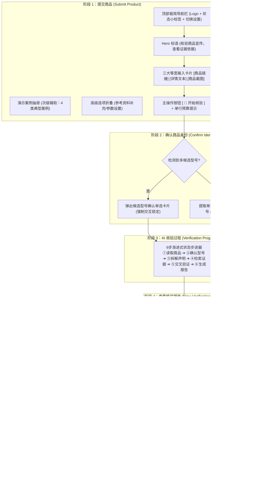
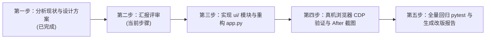

# ClaimCheck Pro UI/UX 重构方案设计说明书 (UI_REDESIGN_PLAN)

> **文档版本**：V1.0  
> **更新时间**：2026-10-16  
> **角色视角**：高级产品设计师 · UI/UX 设计师 · 信息架构师 · Streamlit 前端工程师  
> **重构目标**：将 ClaimCheck Pro 从“开发调试后台”蜕变为“现代、可信、极简、高保真”的 AI 生产力与证据审查 SaaS 产品。

---

## 一、当前界面的深层问题诊断 (Current UI/UX Audit)

通过对现有运行页面（`http://127.0.0.1:8501`）及截取的 Before 截图（[before_homepage.png](file:///D:/ClaimCheck_Pro/screenshots/ui_redesign/before_homepage.png) 与 [before_results_dashboard.png](file:///D:/ClaimCheck_Pro/screenshots/ui_redesign/before_results_dashboard.png)）进行详尽审查，识别出以下 10 项核心体验与信息架构痛点：

```
┌────────────────────────────────────────────────────────────────────────────────────────┐
│ 🔴 现有界面痛点示意图                                                                    │
├──────────────────────┬─────────────────────────────────────────────────────────────────┤
│ 1. 侧边栏过宽(35%)   │ 2. 模式切换、测试连接、Token、超时、费用说明堆积在侧边栏，干扰核心流程  │
│    占据主视觉且不可折叠│ 3. 页面标题使用深色(#1E293B)，在深色背景(#0E1117)下对比度严重不足无法阅读 │
├──────────────────────┼─────────────────────────────────────────────────────────────────┤
│ 4. 黄色Mock警告横幅  │ 占满全屏宽度，明黄刺眼，首屏首先看到大段警告，给用户造成“系统故障”错觉  │
├──────────────────────┼─────────────────────────────────────────────────────────────────┤
│ 5. 语义色混淆        │ 红色被同时用在主按钮(Streamlit primary默认红)、错误提示与冲突结论      │
├──────────────────────┼─────────────────────────────────────────────────────────────────┤
│ 6. 多按钮层级混乱    │ “解析网页”、“清洗文本”、“执行OCR”与“开始核验”按钮平级并存，操作路径断裂   │
├──────────────────────┼─────────────────────────────────────────────────────────────────┤
│ 7. 缺少最大宽度限制  │ 宽屏下输入框无限拉伸，行长过长，导致视觉分散与排版脆弱                  │
├──────────────────────┼─────────────────────────────────────────────────────────────────┤
│ 8. 调试感重 / 文本过密│ 大段开发者说明、规则细则铺满页面，普通用户难以快速理解“第一步该干什么”    │
├──────────────────────┼─────────────────────────────────────────────────────────────────┤
│ 9. HTML标签裸露Bug   │ Markdown中存在未转义的 `<br>` 字符直接显示在页面上                      │
├──────────────────────┼─────────────────────────────────────────────────────────────────┤
│ 10. 缺乏状态渐进式展现│ 未开始核验前显示空白或零散占位，点击后缺乏清晰的核验流水线步骤指示器     │
└──────────────────────┴─────────────────────────────────────────────────────────────────┘
```

---

## 二、新版信息架构与四大阶段工作流 (Information Architecture)

新界面严格重构为**基于用户心智模型的四大渐进式核心阶段**：



---

## 三、界面线框结构与布局设计 (Wireframe & Layout)

### 3.1 容器宽度与栅格规范
- **主视口限制**：设置最大宽度 `max-width: 1140px`，大屏自动居中（`margin: 0 auto`）。
- **栅格系统**：
  - 桌面端：采用 12 列响应式栅格，统计卡片 4 列均分，证据与建议 2 列对齐。
  - 移动端：自动流式折叠为单列（1 Column），按钮全宽触控。

### 3.2 布局线框草图 (ASCII Wireframe)

```text
+---------------------------------------------------------------------------------------+
|  🔍 ClaimCheck Pro  |  商品宣传声明可信核验            [🟢 Mock演示模式 ⚙️设置] [新建核验] |  <-- 顶部轻量导航
+---------------------------------------------------------------------------------------+
|                                                                                       |
|                                    【 阶段 1：提交商品 】                                |
|                                                                                       |
|                     核验商品宣传，查看证据依据                                            |  <-- Hero 区域
|     提交商品链接、详情文本或截图，ClaimCheck Pro 将识别商品型号并核验核心宣传声明。          |
|                                                                                       |
|     +---------------------------------------------------------------------------+     |
|     |  [ 🔗 商品公开链接 ]   |   [ 📝 商品详情文本 ]   |   [ 🖼️ 商品宣传截图 ]    |     |  <-- 等宽输入Tab
|     +---------------------------------------------------------------------------+     |
|     |                                                                           |     |
|     |  商品链接 URL                                                             |     |
|     |  [ https://item.jd.com/1008695271.html                                  ] |     |
|     |                                                                           |     |
|     |  💡 没有商品？试用演示案例 ▾ (展开4个卡片: 官方支持 / 部分支持 / 冲突 / 不足)  |     |
|     |                                                                           |     |
|     |  ▸ ⚙️ 高级选项 (可选：手动补充官方参考资料、调整声明数量等)                     |     |
|     +---------------------------------------------------------------------------+     |
|                                                                                       |
|                                  [ 🚀 开始核验 ]                                       |  <-- 独立品牌色主CTA
|             预计：最多 5 条声明 · 约 3 次模型调用 · 零 API 费用 (Mock演示) ⓘ详情         |  <-- 单行紧凑预算提示
|                                                                                       |
| - - - - - - - - - - - - - - - - - - - - - - - - - - - - - - - - - - - - - - - - - - - |
|                                                                                       |
|                                   【 阶段 3：核验步进器 】                               |
|   (✓) 读取商品信息 ── (✓) 确认型号 ── (✓) 拆解声明 ── (✓) 检索证据 ── (✓) 交叉验证 ── (✓) 报告 |
|                                                                                       |
| - - - - - - - - - - - - - - - - - - - - - - - - - - - - - - - - - - - - - - - - - - - |
|                                                                                       |
|                                   【 阶段 4：核验结果看板 】                             |
|  +---------------------------------------------------------------------------------+  |
|  |  📝 总体核验综合摘要：各项宣传均获得同型号A级官方规格书与实测充分支持，结论确凿。  |  |  <-- 综合结论
|  +---------------------------------------------------------------------------------+  |
|                                                                                       |
|  +-------------------+ +-------------------+ +-------------------+ +---------------+  |
|  | 🟢 有证据支持   3 | | 🟡 部分支持     0 | | 🔴 存在冲突     0 | | ⚪ 证据不足 0 |  |  <-- 四级统计
|  +-------------------+ +-------------------+ +-------------------+ +---------------+  |
|                                                                                       |
|  +---------------------------------------------------------------------------------+  |
|  | 🏷️ 商品身份档案：声学极客 SoundPro X1 (曜石黑 降噪旗舰版) · 置信度 98% · 销售地:中国|  |  <-- 商品档案
|  +---------------------------------------------------------------------------------+  |
|                                                                                       |
|  ▼ 声明 1：主动降噪最大深度达到48dB  [🟢 有证据支持 · 96%]                              |  <-- 折叠卡片默认收起
|  ▼ 声明 2：支持LHDC 5.0蓝牙高清解码  [🟢 有证据支持 · 98%]                              |
|  ▼ 声明 3：整机综合续航可达40小时     [🟢 有证据支持 · 95%]                              |
|                                                                                       |
|  +-------------------------------------+ +-----------------------------------------+  |
|  | 📋 人工确认清单                      | | 🛒 购买前防坑建议                        |  |  <-- 建议分栏
|  | ⚠️ 需确认手机芯片是否支持LHDC 5.0     | | 💡 建议在官方直营店购买索取正规发票      |  |
|  +-------------------------------------+ +-----------------------------------------+  |
|                                                                                       |
|         [ 📥 下载 Markdown 报告 ]   [ 📄 下载 TXT 报告 ]   [ 🔄 新建核验 ]            |  <-- 报告导出操作
+---------------------------------------------------------------------------------------+
```

---

## 四、视觉设计系统 (Design System)

### 4.1 语义色彩体系 (Color Palette)

严格控制颜色数量，告别高饱和争夺，采用专业 Calm & Trustworthy 现代暗黑模式调色板：

| 语义变量 | 色值 Hex | 应用场景 |
| :--- | :---: | :--- |
| **主品牌色 (Primary Brand)** | `#5B8DEF` | 主操作按钮、选中的 Tab 边框、活跃步进、外链文字 |
| **主品牌色悬停 (Hover)** | `#4A7BD9` | 按钮悬停、激活交互态 |
| **页面基底 (Background)** | `#0E1117` | 全局页面背景，消除过曝 |
| **一级表面 (Surface 1)** | `#151A23` | 卡片容器、Tab 背景、输入框外壳 |
| **二级表面 (Surface 2)** | `#1B2230` | 内部高亮区块、展开折叠区域、选中项背景 |
| **主标题与正文 (Text Primary)** | `#F3F6FA` | 页面主标题（彻底解决低对比度看不清问题）、卡片标题、主事实 |
| **次级说明 (Text Secondary)** | `#AAB4C3` | 副标题、字段标签、证据描述、参数说明 |
| **弱化文字 (Text Muted)** | `#748094` | 时间戳、版权、免责细则、未激活状态 |
| **有证据支持 (Supported)** | `#35B779` | 成功通过、A级支持徽标、支持数量卡片 |
| **部分支持 (Partial)** | `#E5A93D` | 琥珀黄色、前置条件遗漏、注意提醒 |
| **存在冲突 (Conflict / Danger)** | `#E45858` | 权威数据相左、错误、高危警示（**红色仅限于此**） |
| **证据不足 (Insufficient / Neutral)**| `#7F8A9A` | 缺少资料、中立客观、未证实状态 |
| **卡片边框 (Border)** | `rgba(255, 255, 255, 0.08)` | 1px 细微边界，避免强对比线框 |

### 4.2 字体系统 (Typography)
- **字体栈**：`system-ui, -apple-system, "Segoe UI", Roboto, "PingFang SC", "Microsoft YaHei", sans-serif`
- **字号与层级**：
  - Hero 主标题：`32px`，Font-weight: 700，Line-height: 1.25，颜色 `#F3F6FA`
  - Hero 副标题：`16px`，Font-weight: 400，Line-height: 1.6，颜色 `#AAB4C3`
  - 阶段区块标题：`20px`，Font-weight: 600，Line-height: 1.4，颜色 `#F3F6FA`
  - 卡片主标题：`16px`，Font-weight: 600，Line-height: 1.4
  - 正文字体：`14px`，Line-height: 1.6，颜色 `#E2E8F0`
  - 辅助/徽标文字：`12px`，Line-height: 1.4，颜色 `#748094`

### 4.3 空间与圆角 (Spacing & Radius)
- **卡片圆角**：`12px ~ 14px`，柔和精致现代 SaaS 质感；
- **按钮圆角**：`10px`，高度统一为 `44px ~ 46px`；
- **卡片内边距**：`18px ~ 20px`；
- **组件垂直外间距**：`16px ~ 20px`。

---

## 五、模块重构与代码拆分计划 (Code Modularization)

为确保代码结构干净、便于维护且易于未来迁移至 Flutter，本次将在 `streamlit_app/` 下创建模块化的 UI 层结构：

```
D:\ClaimCheck_Pro\streamlit_app\
├── ui\                                # 【新增】独立前端视觉与交互组件包
│   ├── __init__.py
│   ├── theme.py                       # 集中式 CSS 样式注入、语义色变量、卡片与输入容器样式
│   ├── components.py                  # 纯展示型组件函数（顶部导航、Hero、模式小胶囊、预算提示、步进器）
│   └── layout.py                      # 页面居中容器约束与响应式骨架控制
├── app.py                             # 【重构】主交互驱动文件，大幅精简，完全复用现有逻辑与 State
├── config.py                          # 维持现有配置不变
├── mock_provider.py                   # 维持现有不变
├── report.py                          # 维持现有不变
└── schemas.py                         # 维持现有不变
```

### 业务与核心逻辑保持完全隔离与不变：
- 严格遵循**零修改现有核心分析逻辑**原则；
- 不改动 `src/providers/*`；
- 不改动 `src/verifier/*`；
- 不改动 `src/crawlers/*`；
- 不改动 `src/ocr/*`；
- 现有 `tests/test_fixed_t01_to_t08.py` 及全量 41 项 pytest 测试用例保持 100% 绿标兼容。

---

## 六、改版执行里程碑与验证计划 (Execution Steps)



1. **第一步与第二步（当前已就绪）**：
   - 提取现有界面缺陷，截取 Before 图像；
   - 编写 `UI_REDESIGN_PLAN.md`；
   - 暂停并向用户汇报方案等待审核。
2. **第三步（审核通过后执行）**：
   - 编写 `streamlit_app/ui/theme.py`（设计系统样式库）；
   - 编写 `streamlit_app/ui/components.py`（导航栏、输入卡片、折叠面板、统计看板、结果呈现）；
   - 重构 `streamlit_app/app.py`（按四大阶段调度流程，清理 `<br>` Bug，移除臃肿侧边栏，将服务模式移至顶部紧凑胶囊设置）；
3. **第四步**：
   - 重启 Streamlit 服务；
   - 使用 Edge CDP 自动截取改版后高清截图（`after_homepage.png`, `after_results_dashboard.png`），存入 `screenshots/ui_redesign/`；
4. **第五步**：
   - 执行 `pytest -v` 验证全量 41 项用例 100% 绿标；
   - 编写并交付 `reports/ui_redesign_report.md`。
