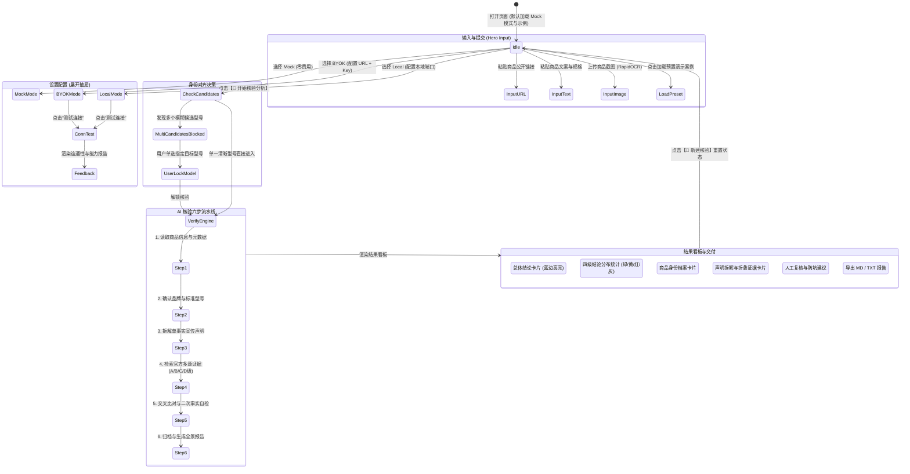

# ClaimCheck Pro 白色专业主题 (White/Light SaaS) UI 重构规划方案

> **文档标识**：`WHITE_UI_REDESIGN_PLAN.md`  
> **重构目标**：将当前深色界面升级为现代、干净、专业、可信赖的白色主题（Modern Clean SaaS），增强信息易读性与对比度，保持底层业务逻辑 100% 隔离无损。  
> **生效范围**：仅修改前端布局、CSS 样式、设计系统 Tokens 与组件表现层；严格禁止触碰核心核验流水线、Provider 逻辑、Mock 结构与测试用例。

---

## 一、页面线框图与信息架构 (Wireframe & Information Architecture)

### 1.1 页面全局 ASCII 线框图 (Desktop Layout)

```text
+--------------------------------------------------------------------------------------------------+
|  🔍 ClaimCheck Pro  商品宣传真实性与参数证据核验系统      [🟢 Mock演示模式]  [⚙️ 服务设置]  [🔄 新建核验]  | <- Top Navbar (#FFFFFF, h:64px)
+--------------------------------------------------------------------------------------------------+
|                                                                                                  |
|  [▼ ⚙️ 服务模式与端点设置 (展开式抽屉，默认折叠)]                                                    |
|  +--------------------------------------------------------------------------------------------+  |
|  | 模式单选：(•) Mock 演示模式   ( ) BYOK 自带API   ( ) Local 本地模型                             |  |
|  | [Base URL] [API Key (密文+脱敏)] [Model] [高级参数折叠]                                      |  |
|  | [🔌 测试连接] -> [反馈横幅：✅ 连接成功 / ❌ 失败原因]  |  [单行预算说明：零API费用 / 自有账户计费]   |  |
|  +--------------------------------------------------------------------------------------------+  |
|                                                                                                  |
|                             ==================================                                   |
|                                核验商品宣传，查看真实依据                                        | <- Hero Title (#0F172A, 28px)
|                输入商品链接、粘贴详情文本或上传商品截图，对比官方资料与权威评测                  | <- Hero Subtitle (#475569, 15px)
|                             ==================================                                   |
|                                                                                                  |
|                      [ 🟢 Mock 演示模式 · 离线标准知识库毫秒级比对 · 零 API 费用 ]                 | <- Status Pill (Subtle)
|                                                                                                  |
|  +--------------------------------------------------------------------------------------------+  |
|  | 📥 第一阶段：提交商品 (Main Card: #FFFFFF, Border: #E2E8F0, Radius: 14px)                   |  |
|  |                                                                                            |  |
|  | [ 🔗 商品公开链接 ]       [ 📝 商品详情文本 ]       [ 🖼️ 商品宣传截图 ]                      | <- Modern Tabs
|  | +----------------------------------------------------------------------------------------+ |  |
|  | | [ https://item.jd.com/...                                                            ] | |  |
|  | | 🔒 安全保障：自动拦截内网 SSRF 风险；遇登录墙或验证码自动合规降级。                     | |  |
|  | +----------------------------------------------------------------------------------------+ |  |
|  |                                                                                            |  |
|  | [💡 没有商品？试用预置演示案例 (次级辅助抽屉)]                                             |  |
|  | [⚙️ 高级选项：参考资料与补充材料 (可选)]                                                   |  |
|  |                                                                                            |  |
|  | +-----------------------------------------------------------+  +-------------------------+ |  |
|  | | 🚀 开始核验分析 (Brand Primary Blue: #2563EB, h:48px)     |  | 🧹 清空内容 (#FFFFFF)   | |  |
|  | +-----------------------------------------------------------+  +-------------------------+ |  |
|  |                                                                                            |  |
|  | ⏱️ 预计：最多 5 条宣传声明 · 预置数据毫秒级比对 · 零 API 费用 (Mock演示)                    |  |
|  +--------------------------------------------------------------------------------------------+  |
|                                                                                                  |
|  +--------------------------------------------------------------------------------------------+  |
|  | 🎯 第二阶段：商品身份确认 (仅在识别出多候选型号时激活拦截，单选锁定目标型号)                  |  |
|  +--------------------------------------------------------------------------------------------+  |
|                                                                                                  |
|  ====================================== 核验结果展示区 =====================================      |
|                                                                                                  |
|  +--------------------------------------------------------------------------------------------+  |
|  | 🚦 第三阶段：AI 核验执行进度                                                                |  |
|  | [✓ 1.读取商品] -> [✓ 2.确认品牌型号] -> [✓ 3.拆解声明] -> [✓ 4.检索证据] -> [✓ 5.交叉比对] -> [● 6.报告] |  |
|  +--------------------------------------------------------------------------------------------+  |
|                                                                                                  |
|  +--------------------------------------------------------------------------------------------+  |
|  | 📊 第四阶段：核验结果看板                                                                  |  |
|  |                                                                                            |  |
|  | +----------------------------------------------------------------------------------------+ |  |
|  | | 总体核验综合结论 (Left Border: 4px solid #2563EB)                                      | |  |
|  | | 核心声明核验通过率高，降噪深度与续航指标经官方说明书印证，但宣传文案省略了限定测试条件。| |  |
|  | +----------------------------------------------------------------------------------------+ |  |
|  |                                                                                            |  |
|  | +------------------+  +------------------+  +------------------+  +----------------------+ |  |
|  | | 🟢 有证据支持: 2 |  | 🟡 部分支持: 2   |  | 🔴 存在冲突: 0   |  | ⚪ 证据不足: 0       | |  |
|  | | 权威资料充分印证 |  | 核心成立但省条件 |  | 参数与说明书矛盾 |  | 未检索到有效凭证     | |  |
|  | +------------------+  +------------------+  +------------------+  +----------------------+ |  |
|  |                                                                                            |  |
|  | +----------------------------------------------------------------------------------------+ |  |
|  | | 🏷️ 商品身份确认档案 (Product Identity)                           识别置信度 98% [Badge]  | |  |
|  | | 品牌：SoundPro    型号：X1 Flagship    版本：曜石黑降噪版    销售地区：中国大陆 (CN)       | |  |
|  | +----------------------------------------------------------------------------------------+ |  |
|  |                                                                                            |  |
|  | 📑 宣传声明拆解与多源证据核验明细 (每项独立折叠卡片，微边框，白色背景)                       |  |
|  | [▶ 声明 1：双馈主动降噪高达 48dB                [🟢 有证据支持 · 95%]   (点击展开证据)]     |  |
|  | [▼ 声明 2：综合续航达 40 小时                   [🟡 部分支持 · 88%]                         |  |
|  |   ├─ 宣传原文摘录：“综合续航达 40 小时，告别电量焦虑”                                     |  |
|  |   ├─ 单一可验证事实：开启降噪与关闭降噪的综合使用时长                                      |  |
|  |   ├─ 深度分析理由：40小时仅在关闭ANC、AAC编码、50%音量下测得；开启ANC时实际仅28小时。       |  |
|  |   └─ 🔗 支撑证据列表 (8项规范字段卡片)：                                                    |  |
|  |      +----------------------------------------------------------------------------------+  |  |
|  |      | 1. [A级·官方规格] SoundPro X1 官方用户手册技术规格书 [🔗 来源链接]                   |  |  |
|  |      | 来源：品牌官网规格 ｜ 发布：2024-03 ｜ 型号状态：✅ 同型号对齐 ｜ 倾向：🟡 部分支持   |  |  |
|  |      | “测试环境：关闭ANC模式、50%音量、AAC格式播放，续航可达40小时；开启ANC时单次续航约7h”  |  |  |
|  |      +----------------------------------------------------------------------------------+  |  |
|  | [▶ 声明 3：搭载旗舰级动圈发声单元              [🟢 有证据支持 · 92%]   (点击展开证据)]     |  |
|  |                                                                                            |  |
|  | +-------------------------------------+  +-----------------------------------------------+ |  |
|  | | 📋 人工复核清单 (Checklist)         |  | 🛒 购买前防坑建议 (Advice)                    | |  |
|  | | ⚠️ 建议核对包装盒实际执行标准防伪码  |  | 💡 开启降噪后续航有所下降，属于行业正常物理特性| |  |
|  | +-------------------------------------+  +-----------------------------------------------+ |  |
|  |                                                                                            |  |
|  | ⚖️ 客观中立声明：本报告由多源公开权威资料比对生成，仅供消费者决策参考，不作为法律鉴定依据。  |  |
|  |                                                                                            |  |
|  | [📥 下载 Markdown 报告 (.md)]       [📄 下载纯文本报告 (.txt)]       [🔄 开始新的一项核验]  |  |
|  +--------------------------------------------------------------------------------------------+  |
|                                                                                                  |
|  ClaimCheck Pro V0.1 · 纯本地运行与数据隐私安全 · 严守零费用架构规范                             | <- Footer (#94A3B8)
+--------------------------------------------------------------------------------------------------+
```

### 1.2 页面状态迁移流程图 (Mermaid Stateflow)



---

## 二、白色主题设计系统与 Color Tokens (Design System)

### 2.1 基础色彩空间规范 (Color Palette)

依据现代专业 SaaS（如 Stripe / Linear / Vercel Light）设计语言，构建全局色阶：

| Token 名称 | 变量名 | 十六进制 (Hex) | 语义与视觉用途 | WCAG AA 对比度 |
| :--- | :--- | :--- | :--- | :--- |
| **页面底色** | `bg_canvas` | `#F8FAFC` | 页面最底层背景画布，柔和不刺眼的高级浅灰蓝 | 基准底色 |
| **纯白主容器** | `surface_card` | `#FFFFFF` | 主卡片、输入框、展开抽屉、结果看板的纯白背景 | - |
| **次级背景** | `surface_muted`| `#F1F5F9` | 步进器底色、表格斑马纹、标签背景、嵌套证据卡片底色 | - |
| **高亮悬停** | `surface_hover`| `#E2E8F0` | 按钮悬停、交互元素 hover 背景 | - |
| **主标题色** | `text_primary` | `#0F172A` | 顶栏产品名、大标题、卡片标题、声明核心文字 (深暗蓝灰色) | **14.2:1** (极高) |
| **正文次级** | `text_secondary` | `#475569` | 副标题、分析理由、正文说明、字段标签 | **7.1:1** (AAA级) |
| **辅助弱化** | `text_muted` | `#64748B` | 占位符、时间戳、免责声明、页脚说明 | **4.6:1** (AA级) |
| **极弱占位** | `text_light` | `#94A3B8` | 禁用态文字、微边框小图标 | - |
| **细微边框** | `border_subtle`| `#E2E8F0` | 卡片外框、模块分割线、折叠器边框 | - |
| **强调边框** | `border_strong`| `#CBD5E1` | 输入框默认边框、次级按钮边框 | - |

### 2.2 品牌主色 (Brand Tokens)

| Token 名称 | 变量名 | 十六进制 (Hex) | 语义与用途 |
| :--- | :--- | :--- | :--- |
| **品牌主色** | `brand_primary` | `#2563EB` | 主操作按钮（开始核验）、激活Tab、关键高亮指示 (Royal Blue) |
| **品牌悬停** | `brand_hover` | `#1D4ED8` | 主按钮鼠标悬停背景色 |
| **品牌浅底** | `brand_light_bg`| `#EFF6FF` | 激活步骤高亮、引用块底色、品牌徽标浅底 |
| **品牌聚焦光圈**| `brand_focus` | `rgba(37, 99, 235, 0.18)` | 输入框聚焦时的外发光阴影 ring |

### 2.3 结论四级语义色 (Semantic Conclusion Tokens)

> **原则**：红色严格仅保留给“存在冲突”和“严重报错”，绝不用于普通按钮或普通强调。所有状态均配备**浅色柔和底色 + 深色高对比文字 + 微边框**。

| 结论类别 | 状态文字色 | 状态背景色 (Light Tint) | 边框强调色 | 视觉用途与心理映射 |
| :--- | :--- | :--- | :--- | :--- |
| **🟢 有证据支持** | `#15803D` (深绿) | `#F0FDF4` (极浅绿) | `#86EFAC` | 官方材料充分印证，安全可信 |
| **🟡 部分支持** | `#B45309` (琥珀棕) | `#FFFBEB` (极浅黄) | `#FDE68A` | 结论成立但省略前置条件或存在温差 |
| **🔴 存在冲突** | `#B91C1C` (深红) | `#FEF2F2` (极浅红) | `#FCA5A5` | **唯一允许红色的场景**：标称与官方事实矛盾 |
| **⚪ 证据不足** | `#475569` (石板灰) | `#F8FAFC` (浅灰) | `#CBD5E1` | 检索未果，严守二次自检不误判 |

---

## 三、四大阶段与组件重构规范 (Component Specifications)

### 3.1 顶栏 (Top Navbar)
- **容器**：`#FFFFFF` 背景，高度 `64px`，底边 `1px solid #E2E8F0`，圆角 `12px`，内边距 `0.75rem 1.25rem`。
- **左侧**：放大镜图标 `🔍` + `ClaimCheck Pro`（加粗 1.25rem `#0F172A`）+ 辅助 Slogan 胶囊（`#F1F5F9` 底色 `#64748B` 小字）。
- **右侧**：
  - 运行模式 Badge（Mock 为 `#F0FDF4` 绿底绿字；BYOK 为 `#EFF6FF` 蓝底蓝字；Local 为 `#F5F3FF` 紫底紫字）。
  - “🔄 新建核验”轻量操作按钮（白色底、灰色细边框，鼠标悬停变为浅灰）。

### 3.2 展开式设置抽屉 (Settings Drawer)
- **外观**：纯白底色折叠卡片，微边框。
- **内部排版**：
  - 服务模式选择器采用纯白底单选块。
  - BYOK 表单：输入框统一纯白背景 + `#CBD5E1` 边框，聚焦时呈现 `2px solid #2563EB`。
  - API Key 字段强制密码遮罩，下方显示已脱敏指纹（如 `sk-****3f9a`）。
  - “🔌 测试连接”按钮采用次级按钮样式。
  - 测试结果以浅底 Alert 展示：成功为绿色轻量胶囊（响应时间毫秒级、文本/JSON/多模态支持度），失败为浅红色清晰原因。

### 3.3 主操作区 (Hero & Input Container)
- **宽度**：`max-width: 1040px` 严格居中，自适应移动端与宽屏。
- **Hero 文字**：
  - 主标题：`font-size: 2rem; font-weight: 700; color: #0F172A;`
  - 副标题：`font-size: 1rem; color: #475569;`
- **输入方式 Tabs**：
  - Tab 容器为 `#F1F5F9` 灰色底轨，选中的 Tab 为纯白实体卡片，带极轻微投影和品牌文字色。
  - 链接输入：带清晰的 `https://...` 提示和 SSRF 安全说明。
  - 详情文本：高度适中的多行文本框，带规范化清洗说明。
  - 截图上传：RapidOCR 本地离线处理区，卡片式双列布局（左侧优化预览，右侧离线文字提取与填入）。
- **辅助入口**：
  - “💡 没有商品？试用预置演示案例”采用浅色小折叠抽屉，内置 4 个典型案例快捷载入按钮。
  - “⚙️ 高级选项”折叠区：供用户手动粘贴参考链接与官方说明书文本。
- **主按钮 (CTA)**：
  - 蓝色大按钮 `#2563EB`，高 `48px`，圆角 `10px`，字重 600，悬停变为 `#1D4ED8`。
  - 并在右侧配白色“🧹 清空内容”次级按钮。
  - 下方伴随一行浅灰色单行预算提示，不喧宾夺主。

### 3.4 核验执行进行态 (Process Stepper)
- 纯白背景扁平容器，上底带有淡灰边框。
- 六步横向流：
  `1.读取商品信息 ➔ 2.确认品牌型号 ➔ 3.拆解宣传声明 ➔ 4.检索公开证据 ➔ 5.多源交叉比对 ➔ 6.生成核验报告`
- 已完成步骤使用绿色对勾 `✓`，进行中步骤使用品牌蓝小圆点 `●`，未开始步骤使用柔和灰色。

### 3.5 结果看板 (Verification Dashboard)
- **第 1 层：综合结论卡片**
  - 白色卡片，左侧带有 `4px solid #2563EB` 装饰线，深色清晰标题与总体判断陈述。
- **第 2 层：四级指标分布卡片**
  - 4 等分并排卡片（有证据支持 / 部分支持 / 存在冲突 / 证据不足）。
  - 每张卡片顶部带有对应语义色彩条（3px），卡片背景为柔和浅色（绿色对应 `#F0FDF4`，黄色对应 `#FFFBEB`，红色对应 `#FEF2F2`，灰色对应 `#F8FAFC`），大字号展示计数。
- **第 3 层：商品身份档案**
  - 白色卡片，4 列网格（品牌、型号、版本/规格、销售地区），右上角显示置信度胶囊徽章。
- **第 4 层：声明拆解与多源证据列表**
  - 每条声明独立封装为一个 `st.expander` 卡片，标题栏清晰显示序号、声明原文、核验结论徽章（带对应颜色）。
  - 展开后展示：宣传原文摘录、单一可验证事实、核验指标、深度分析理由、二次事实自检轨迹。
  - 嵌套证据卡片：采用更浅的 `#F8FAFC` 背景与 `#E2E8F0` 边框，8 项规范字段完整排列（级别徽标 A/B/C/D、标题链接、来源类型、发布时间、型号对齐状态、关键摘录高亮块、倾向徽标）。
- **第 5 层：人工复核清单与防坑建议**
  - 双列白色卡片，清单条目使用浅黄/浅绿底色的标准提示块。
- **第 6 层：报告导出与操作栏**
  - 次级扁平按钮（白色底灰色框），下载 Markdown 与 TXT 格式报告，提供持久化路径提示。

---

## 四、待修改文件清单 (Files to Modify)

本次重构严格局限于表现层与布局层，绝不跨层修改后端逻辑：

| 文件路径 | 修改性质 | 核心修改内容说明 |
| :--- | :--- | :--- |
| `streamlit_app/ui/theme.py` | **核心重写** | 1. 将 `COLORS` 字典完全更新为白色主题系统 Token。<br>2. 注入全局 Light CSS，将 `.stApp`、`.block-container`、文字、输入框、按钮等全面覆写为浅色 SaaS 风格，彻底消除深黑底色。<br>3. 优化卡片边框、投影、圆角与间距。 |
| `streamlit_app/ui/components.py` | **核心重构** | 1. 调整顶栏、Hero、状态胶囊、指标卡片、身份卡片、声明列表、证据卡片等所有组件生成的 HTML/CSS 类名与内联样式。<br>2. 确保所有文字颜色对比度符合 WCAG AA 标准（深暗色 `#0F172A` / `#475569`），消灭深色背景残留。<br>3. 修复所有 HTML 标签闭合与转义规范。 |
| `streamlit_app/ui/layout.py` | **核心重构** | 1. 优化展开式设置抽屉内的单选框、输入框和测试连接排版。<br>2. 重构连接测试反馈横幅（成功绿底、失败浅红底）。 |
| `streamlit_app/app.py` | **轻量调整** | 1. 确认主流程四阶段结构与白色主题组件顺畅联动。<br>2. 保持所有 Session State 状态键值不变。<br>3. 确保多候选型号拦截与确认逻辑正常运转。 |
| `.streamlit/config.toml` | **新建配置** | 显式声明 Streamlit 原生浅色主题基线（`base="light"`, `primaryColor="#2563EB"` 等），避免浏览器或系统暗色偏好强行反色。 |

---

## 五、保留功能与无损保证清单 (Preserved Features)

为确保整个项目业务完整性与质量合规，本次改版 100% 保留以下功能特性：

1. **零费用架构保障**：
   - 绝不引入任何开发者付费的默认后端 API。
   - 保留离线 Mock 模式、用户自带 API (BYOK) 模式、本地模型 (Local) 模式的三重架构。
2. **安全与隐私铁律**：
   - API Key 严禁写入日志、Git 或持久化文件，仅保留在当前会话内存中，界面强制脱敏显示。
   - 公网 Base URL 强制仅允许 HTTPS。
   - 本地模型严格限制为 localhost / 127.0.0.1 / 局域网。
   - 输入公开链接严格执行 SSRF 安全过滤，遇到登录墙/反爬限制自动降级并不绕过。
   - 截图上传纯本地离线 RapidOCR 处理，0 云端外传。
3. **核验核心业务逻辑**：
   - 严格单次最多处理 5 条宣传声明。
   - 每条声明限定为“单一可验证事实”。
   - 证据来源保持 A/B/C/D 四级分级。
   - 保持型号严格对齐与二次事实自检铁律（未提及不误判为不支持，非同型号不用于强结论）。
   - 四级结论体系保持不变（有证据支持、部分支持、存在冲突、证据不足）。
4. **自动化测试与验收标准**：
   - 保持 41 项自动化测试 100% 通过（T01~T08 固定测试用例，Provider 单元测试，输入测试，核验测试）。

---

## 六、潜在风险点与防范对策 (Risks & Mitigations)

| 风险点 | 风险描述 | 防范与消除措施 |
| :--- | :--- | :--- |
| **1. Streamlit 默认主题冲突** | 若操作系统或浏览器处于 Dark Mode，Streamlit 可能默认应用深色主题，导致部分原生组件背景发黑或文字变白不可见。 | 1. 在工作区创建 `.streamlit/config.toml`，硬性指定 `base = "light"`。<br>2. 在 `theme.py` 的全局 CSS 中使用 `!important` 强力覆写 `.stApp`、`[data-testid="stAppViewContainer"]`、文字和各容器的背景色与前景色。 |
| **2. 浅色模式下文字对比度不足** | 若部分辅助说明、表格表头或链接文字使用过浅的灰色，可能导致用户在阳光下或普通屏幕难以辨识。 | 严格执行 WCAG AA 对比度标准：主正文使用深色 `#0F172A`（对比度 > 14:1），次级正文使用 `#475569`（对比度 > 7:1），链接使用品牌深蓝 `#2563EB`。 |
| **3. 响应式布局与折叠卡片溢出** | 证据卡片字段多达 8 项，在窄屏或移动端可能发生文字拥挤折行或水平溢出。 | 证据卡片使用扁平堆叠布局，长文本关键摘录使用自适应内边距和微缩引用块，链接截短并保留完整在新标签页打开。 |
| **4. 状态丢失或组件重渲染死循环** | 修改组件传参或 UI 结构可能破坏现有 `st.session_state` 的持久性。 | 严格保持现有 `app.py` 中的所有 session_state 变量名与函数签名一致，不修改状态更新流程。 |

---

## 七、阶段执行与交付承诺

1. **第一阶段（当前）**：已完成暗色界面 4 张基线截图留存，完成代码阅读，撰写本规划书并向用户汇报。
2. **第二阶段（待确认后开启）**：创建 `.streamlit/config.toml`，更新 `theme.py`、`components.py`、`layout.py` 与 `app.py`。
3. **第三阶段（验收验证）**：运行 41 项自动化测试，启动浏览器采集改版后 5 张白色界面截图，编写最终对比报告。
